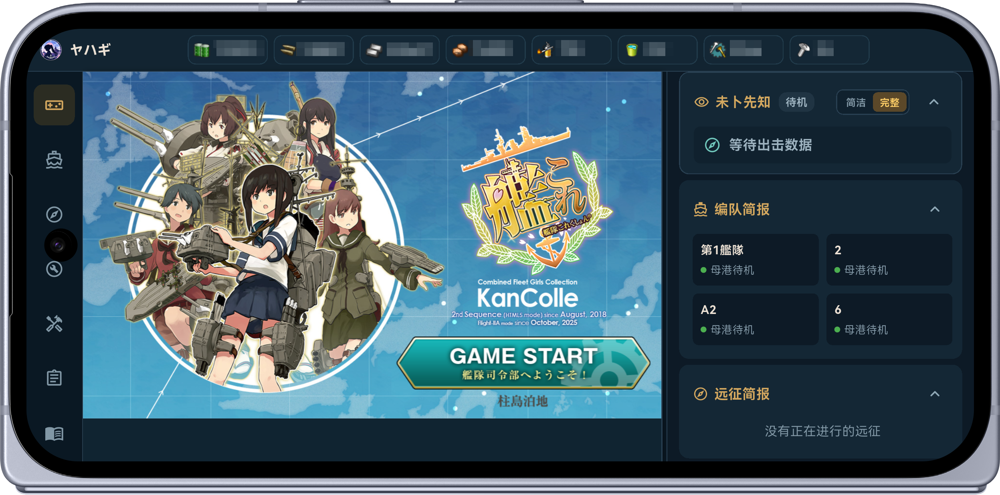
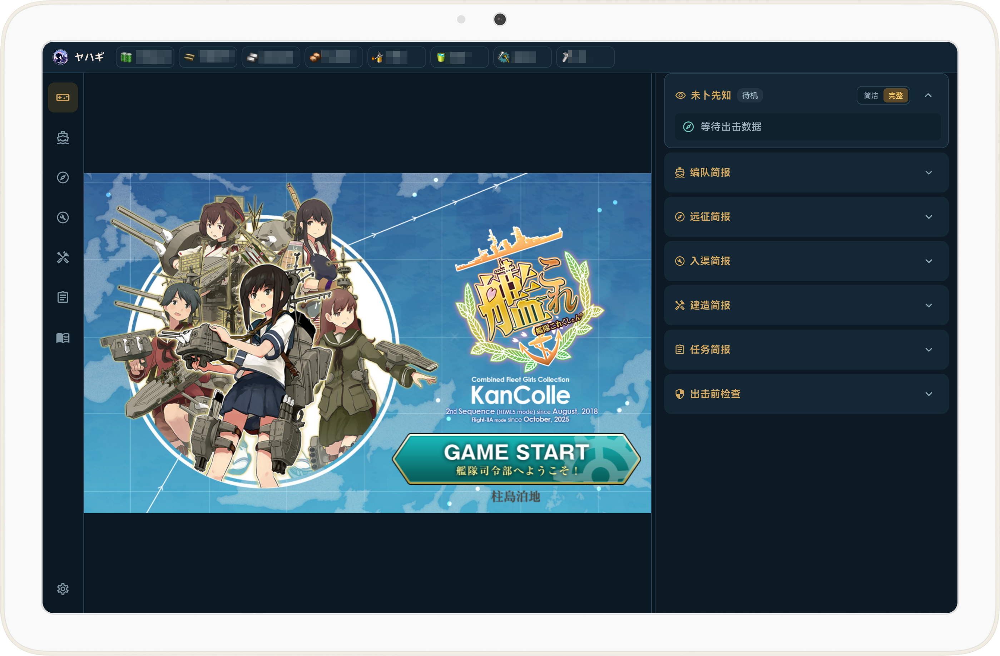
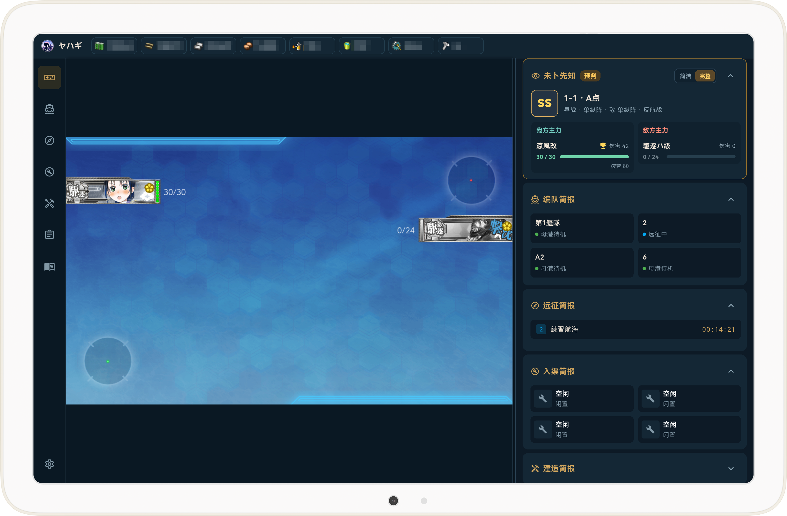
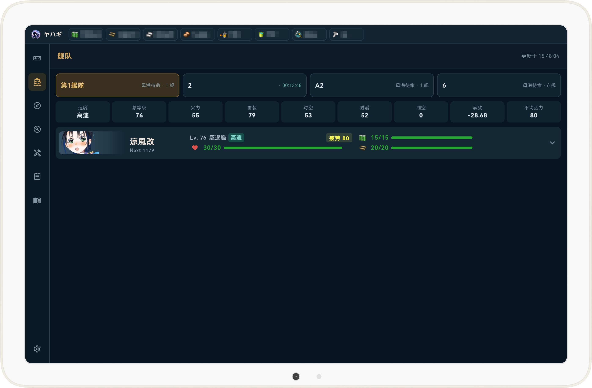
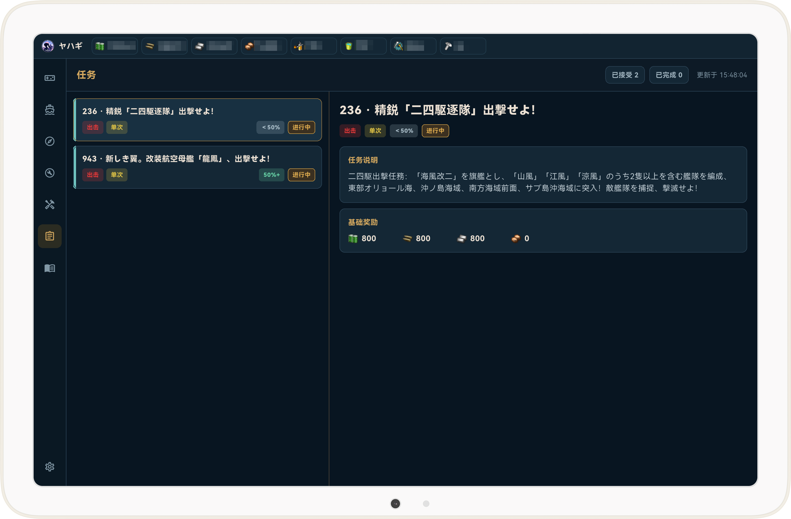

  

# ヤハギ (Yahagi KanColle Browser)

**Fleet information and everyday tools, ready for your next sortie.**

A mobile browser and companion information app for *Kantai Collection* players.

[Official website](https://yahagi.xyz/?lang=en) · [Download](https://github.com/yamatosaki/yahagi-kancolle-browser/releases/latest) · [Release notes](https://github.com/yamatosaki/yahagi-kancolle-browser/releases) · [Report an issue](https://github.com/yamatosaki/yahagi-kancolle-browser/issues)

[简体中文](https://github.com/yamatosaki/yahagi-kancolle-browser/blob/master/README.md) ｜ [繁體中文](https://github.com/yamatosaki/yahagi-kancolle-browser/blob/master/README.zh-Hant.md) ｜ [日本語](https://github.com/yamatosaki/yahagi-kancolle-browser/blob/master/README.ja.md) ｜ English ｜ [한국어](https://github.com/yamatosaki/yahagi-kancolle-browser/blob/master/README.ko.md)

## About

Yahagi brings the game screen and useful companion information together. While playing, you can check fleet status, quest progress, battle predictions, and your logbook. When preparing for a sortie or planning your daily activities, you can also use tools for equipment improvement, development calculations, expedition checks, map information, and experience calculations.

The app supports phones, tablets, and foldable devices, with adjustable information layouts and an HD layout for larger screens. The interface is available in Simplified Chinese, Traditional Chinese, Japanese, English, and Korean.

All in-game actions remain under the player's control. Yahagi organizes information from data already received by the game page. It does not form fleets, resupply, sortie, develop or improve equipment, or accept quests for you.

## Download and installation

Visit [GitHub Releases](https://github.com/yamatosaki/yahagi-kancolle-browser/releases/latest) for published versions, installation packages, and instructions for each release.

| Platform | Availability and notes |
| --- | --- |
| Android | The main version maintained by this project. Download and install the APK from the releases page. |
| iOS | A third-party IPA port by [Kutinana](https://github.com/Kutinana) is available on the releases page. See the relevant release notes for installation instructions, supported features, and maintenance status. |

When updating on Android, follow the release notes and install over the existing app where possible. Before uninstalling, clearing app data, or changing devices, export any logbook and fleet records you want to keep.

## Screenshots

### Phones, tablets, and foldables

<table>
  <tr>
    <td width="33%" align="center">
      
    </td>
    <td width="33%" align="center">
      
    </td>
    <td width="33%" align="center">
      
    </td>
  </tr>
  <tr>
    <td align="center">Phone</td>
    <td align="center">Tablet</td>
    <td align="center">Foldable</td>
  </tr>
</table>

The standard layout suits phones and similar devices. The HD layout is designed for larger windows, including tablets and unfolded foldables. Adjust the information panel's width, module order, and visible items to suit your device and preferences.

### Game and companion information

<table>
  <tr>
    <td width="64%" rowspan="2" align="center" valign="middle">
      
       <strong>Game and battle information</strong>
    </td>
    <td width="36%" align="center">
      
       Fleet information
    </td>
  </tr>
  <tr>
    <td width="36%" align="center">
      
       Quests
    </td>
  </tr>
</table>

## Features

| Feature | What you can do |
| --- | --- |
| Fleet and battle information | Check fleet status, air power, and line of sight; view predicted battle progress and results; check readiness before a sortie. |
| Quests | Look up quest descriptions, rewards, prerequisites, and follow-up quests; filter quests and track individual objectives for supported quests. |
| Ships and equipment | Browse owned and unowned ships and equipment, filter and sort entries, check equipped items, and look up equipment compatibility. |
| Daily planning | Look up equipment improvement schedules and costs, calculate development recipes and probabilities, and check expedition requirements and estimated returns. |
| Senka and training | Review senka records and calendars, plan ranking-point targets, calculate experience and required sorties, and save training goals. |
| Fleet records and maps | Save fleet and land-based air squadron setups, export fleet images and data for external tools, and look up routes, nodes, and enemy ships. |
| Logbook and backups | Browse six types of records and resource trends, filter battle details, and export, sync, or restore logbook and fleet records. |
| Mobile experience | Customize the interface and resource bar, use completion reminders and background countdowns, cache game resources, and configure mouse compatibility. |

### Fleet information and battle prediction

- View ship levels, HP, morale, fuel, ammunition, equipment, and fleet summaries.
- Check air power and line-of-sight estimates, along with expedition, dock repair, construction, and anchorage repair status.
- View battle information for normal and combined fleets, including friendly and enemy HP changes, predicted battle rank, and MVP predictions.
- Use pre-sortie checks, heavy-damage alerts, and pre-battle enemy information.

Battle prediction organizes battle data already received by the game page. Predictions are replaced with confirmed results when the official battle result arrives. Predictions and status alerts are for reference; use the game screen to make your decisions.

### Quests

- Browse accepted quests and the quest catalog; filter and search by type, cycle, and other criteria.
- View quest descriptions, base rewards, prerequisites, and follow-up quests to help plan your quest order.
- Track individual objectives for supported quests and receive completion alerts.
- Update quest data.

Some quest progress is estimated from locally observed activity and records. Progress the app has not observed may be incomplete.

### Ships and equipment

- Browse owned and unowned ships and equipment by category, with filtering and sorting.
- View equipment improvement levels, proficiency, and which ships have items equipped.
- Find ships that can use a piece of equipment, or equipment a ship can use, with normal and expansion slots distinguished.

### Improvement, development, and expedition planning

- **Improvement planning:** Search by day of the week, equipment category, keyword, or favorites; check second-ship requirements, costs, and upgrade paths.
- **Development calculator:** Check development probabilities for target equipment based on the secretary ship and resource input, or find recipes for selected equipment.
- **Expedition checks:** Check requirements for ship types, levels, equipment, supplies, and morale; estimate great-success rates, returns, and completion times.

### Senka and experience planning

- Review local senka information, sortie records, and the senka calendar.
- Plan targets with Extra Operation (EO) and quest senka rewards; estimate the points still needed and your daily target.
- Calculate experience based on the map, route, victory rank, flagship, MVP, and other conditions; estimate the sorties required to level up.
- Save ship training goals and track experience and level progress.

Senka and experience calculations are estimates based on recorded data and the conditions you set.

### Fleet records and map information

- Save current fleet and land-based air squadron setups; find records by name, map, and other criteria.
- Export high-resolution fleet images for sharing and organizing guides.
- Export DeckBuilder data, or choose to open external tools such as the Air Superiority Simulator and Jervis for further calculations.
- View map routes, node types, enemy compositions, formations, experience, and air-power estimates; tap an enemy ship for details.
- Check for map and enemy data updates independently within the app.

Saved fleet setups are for reference and sharing. Fleet changes in the game remain the player's responsibility. Map and enemy data may change with game updates; refer to the actual game state.

### Logbook, resource trends, and backups

- Save six types of records: sorties, expeditions, construction, development, ship removal, and resources.
- Filter sortie records by date, map, status, and other criteria; view node and battle details.
- View resource stockpile trends, changes over a selected period, and historical records.
- Export, share, and restore logbook and fleet records for the current account, or select a document folder for background and manual syncing.

Records accumulate from data the app has actually observed. Backups cover logbook and fleet records, not login usernames or passwords, login cookies, or all app settings.

### Interface, reminders, and game cache

- Use full-screen mode, adjust game scaling and the information panel, and edit home-screen modules by reordering, hiding, or restoring them to the default layout.
- Customize selected items in the fleet summary and top resource bar.
- View reminders and countdowns for expeditions, dock repairs, construction, anchorage repairs, and morale recovery.
- Cache and download game resources locally, with pause, resume, integrity checks, and cleanup.
- Configure display and frame-rate options, external mouse controls, and mouse-wheel compatibility.

Reminders and background operation depend on system permissions and power-saving policies. Resource caching reduces repeated downloads; you still need a connection to the game servers to play.

## Getting started

1. Download a package from the releases page, follow the instructions for that version, and open the app.
2. Choose a connection method and log in on the game page yourself. Configure the system network, an HTTP proxy, or a SOCKS5 proxy if needed.
3. Enter the home port and let the app receive fleet and account data before opening companion pages such as fleets, quests, and inventory.
4. Adjust the layout for your device and configure notifications, caching, and record backups as needed.

The app offers two operating modes:

- **Game information mode:** Reads API responses already received by the game page to enable fleet, quest, battle, logbook, and other information features.
- **Browser-only mode:** Disables API data capture while letting you browse and operate the game page inside the app.

In addition to DMM, the app provides an experimental third-party OOI connection option. When using OOI, your login credentials are submitted to that third-party service. Read and confirm the in-app explanation before using it.

## Data and privacy

Companion records are primarily stored on your device, without requiring a separate app cloud account. Data handling varies by feature:

| Item | How data is handled |
| --- | --- |
| Logbook and fleet records | Stored locally; exported, restored, or synced to a selected document folder at the user's request. |
| Anonymous device and usage statistics | Uses TelemetryDeck for anonymous device information and usage statistics, including the current rendering mode. Enabled by default and can be disabled in settings. |
| KCWiki data contribution | Disabled by default; users may enable it when supported by the app version and configuration. |
| Diagnostic files | Saved manually or sent through the system share sheet by the user. The app does not upload diagnostic files automatically. |

Sensitive parameters such as api_token and api_starttime are removed from game API information used for companion analysis. Record backups do not include login cookies. The system WebView may still retain login state on the device through its default mechanisms.

## Community and feedback

Feedback on your experience, compatibility issues, and feature suggestions is welcome.

I can communicate in Chinese, English, and Japanese. Feel free to contact me in any of these languages.

- **QQ group: 1104904097**
- **Contact email: yamatosaki123[AT] gmail.com**
- **Issue tracker:** [GitHub Issues](https://github.com/yamatosaki/yahagi-kancolle-browser/issues)

When reporting an issue, please include the app version, device model, operating system version, steps to reproduce it, and relevant screenshots where possible.

## Open source and contributing

Yahagi is developed as an open-source project. Issues and pull requests are welcome, including feature improvements, compatibility testing, documentation, and localization.

See [Building and verification](BUILDING.en.md) to build from source, run tests, or build an APK with GitHub Actions in your fork. For UI, resource, and independent app changes, see [Customization and development](CUSTOMIZING.en.md). Before contributing, read the [contribution guide](CONTRIBUTING.en.md) and [security policy](https://github.com/yamatosaki/yahagi-kancolle-browser/blob/master/SECURITY.md).

The source code is licensed under the [MIT License](https://github.com/yamatosaki/yahagi-kancolle-browser/blob/master/LICENSE). See [THIRD_PARTY_NOTICES](https://github.com/yamatosaki/yahagi-kancolle-browser/blob/master/THIRD_PARTY_NOTICES) for third-party fonts, dependencies, and assets.

## Disclaimer

Yahagi is an unofficial, community-developed tool. It is not affiliated with, authorized by, or partnered with the operators or developers of *Kantai Collection*, DMM, or other relevant rights holders.

Users are responsible for understanding and complying with the relevant terms of service and for any account, network, or compatibility risks associated with third-party tools. Game names, trademarks, and third-party assets belong to their respective rights holders.

## Acknowledgments

Special thanks to the [POI browser](https://github.com/poooi/poi) project and its open-source community for the references and inspiration they have provided in data organization, feature design, and community collaboration.

Thank you to [Kutinana](https://github.com/Kutinana) for creating and providing the third-party iOS port.

Thanks also to the maintainers of Flutter, WebView Flutter, and the project's dependencies, and to every admiral who has tested the app, reported issues, or contributed code.

Yahagi is independently developed. Its views and implementation do not represent the official positions of the projects or communities mentioned above.

## Support the project

[Support Yahagi through GitHub Sponsors](https://github.com/sponsors/yamatosaki)

You can also support the project through Alipay or WeChat Pay. Click a QR code to view the original image.

| Alipay | WeChat Pay |
| :---: | :---: |
|  |  |

Thank you for supporting Yahagi! ❤️

Your sponsorship means a great deal to me and is an important source of encouragement to keep developing and improving this open-source project.

Thank you sincerely for your support!
